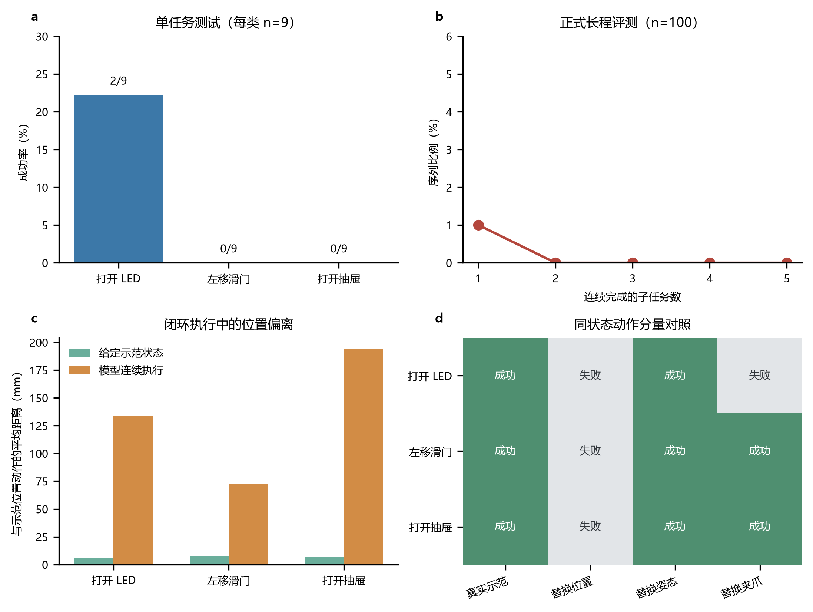
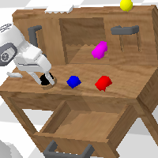
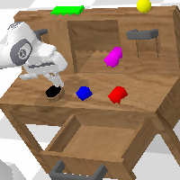
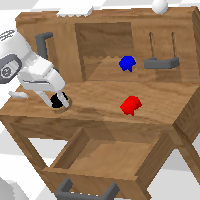
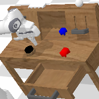

# CALVIN Failure Analysis

[简体中文](https://github.com/chenbinghan666/calvin-failure-analysis/blob/main/README.md) · [English](https://github.com/chenbinghan666/calvin-failure-analysis/blob/main/docs/locales/README.en.md) · [日本語](https://github.com/chenbinghan666/calvin-failure-analysis/blob/main/docs/locales/README.ja.md) · [Deutsch](https://github.com/chenbinghan666/calvin-failure-analysis/blob/main/docs/locales/README.de.md) · **Français** · [Español](https://github.com/chenbinghan666/calvin-failure-analysis/blob/main/docs/locales/README.es.md) · [Português](https://github.com/chenbinghan666/calvin-failure-analysis/blob/main/docs/locales/README.pt.md)

À quelle étape un robot échoue-t-il quand aucune séquence de cinq actions n’aboutit ? L’étude s’appuie sur le simulateur CALVIN et un modèle MCIL public pour examiner les écarts d’action et tester la reprise après échec. Le dépôt contient des figures, des données et un rapport en chinois.

Python · CALVIN · MCIL · [Voir le rapport d'expérience](https://github.com/chenbinghan666/calvin-failure-analysis/blob/main/docs/report.pdf)

Il s'agit d'un projet de recherche à petite échelle basé sur l'environnement de simulation [CALVIN](https://github.com/mees/calvin) et le modèle de pré-formation officiel MCIL.

Le projet se concentre sur les questions suivantes : **Lorsque le taux de réussite d'une tâche robotique longue distance est de 0, où exactement le robot échoue-t-il, pourquoi échoue-t-il et s'il peut récupérer après un échec ?**

Le taux de réussite traditionnel au niveau des tâches ne retient que le succès ou l'échec final et ne permet pas de distinguer les situations suivantes :

- Le modèle ne part pas de la première étape ;
- Le modèle peut effectuer certaines étapes, mais les erreurs s'accumulent dans les tâches ultérieures ;
- Le modèle comprend la tâche, mais le contrôle continu s'éloigne progressivement ;
- Le modèle ne réussit que dans quelques états initiaux ;
- Le modèle ne peut pas se rétablir tout seul après un échec.

## Processus expérimental

1. Rejouez la trajectoire réelle de la démonstration pour vérifier l’environnement, le format de l’action et la détermination du succès.
2. Trois tâches simples consistant à ouvrir la LED, déplacer la porte coulissante vers la gauche et ouvrir le tiroir ont été testées respectivement.
3. Exécutez 100 séquences de programme fixes en cinq étapes et enregistrez SR@1 sur SR@5.
4. Remplacez le lien de défaillance direct du positionnement par la position, l'attitude et l'action de la pince.
5. Réessayez corrigé et continuez les diagnostics après un échec.

## Principaux résultats

| expérimenter | résultat |
|---|---:|
| Allumer la LED | 2/9 |
| porte coulissante à gauche | 0/9 |
| tiroir ouvert | 0/9 |
| 100 séquences de cinq étapes terminées avec succès | 0/100 |
| SR@1 | 1% |
| SR@2—SR@5 | 0% |
| Correction d'une nouvelle tentative de récupération | 0/10 |
| Continuer l'exécution après un échec | 0/50 pas |

Une condition de réussite de la LED est toujours remplie à la 94ème étape d'action après une exécution indépendante, indiquant que le modèle n'est pas complètement incapable, mais qu'il est sensible à l'état initial. La comparaison des composants d'action a montré que les trois types de tâches ont échoué après seulement le remplacement de l'action de position ; lorsqu'elle est exécutée librement, la distance entre l'action de position et la trajectoire de démonstration s'étend jusqu'à 72,9-194,2 mm. Le boîtier LED montrait également une orientation incohérente des pinces à des étapes clés.

Résultats expérimentaux au niveau du processus 

## Cas de réussite et d’échec

| Témoignages de réussite LED : Pour commencer | Histoire de réussite LED : Fin |
|---|---|
|  |  |

| Cas de panne de LED : mise en route | Cas de panne de LED : après avoir exécuté 360 étapes |
|---|---|
|  |  |

## Conclusion

Cette expérience montre que le taux de réussite au niveau des tâches convient pour mesurer l'achèvement final, mais il n'est pas suffisant pour expliquer le processus d'échec des tâches à long terme. Au minimum, la première étape échouée, la durée d'exécution continue, l'écart des composantes du mouvement et les résultats de récupération doivent également être enregistrés.

Les preuves actuelles soutiennent que « l’écart de position en boucle fermée est un lien direct de défaillance commun aux trois types de tâches », mais elles ne peuvent pas être utilisées pour déterminer la seule cause au sein du modèle. Cette conclusion s'applique uniquement aux poids publics, aux données de débogage et aux conditions expérimentales utilisés dans ce projet.

## Structure du projet

```text
.
├── README.md
├── docs/
│   ├── report.pdf                  # Rapport de laboratoire chinois
│   └── internship-summary.md       # Résumé du stage de recherche scientifique
├── figures/                        # Diagramme récapitulatif et captures d'écran du cas
├── results/                        # Résultats de l'expérience JSON vs CSV
└── src/                            # Code d'évaluation et de diagnostic
```

Rapport chinois complet : [docs/report.pdf](../../docs/report.pdf)

Pour la sélection des questions de recherche, les travaux réalisés par moi, le processus de débogage et les limites de la recherche pendant un stage de recherche scientifique, veuillez consulter : [docs/internship-summary.md](../../docs/internship-summary.md).

## Instructions de reproduction

Le code doit être exécuté dans l'environnement officiel CALVIN et préparer :

- Environnement CALVIN avec `calvin_models` ;
- Données de l'environnement D ou données de débogage officielles ;
- Point de contrôle officiel `D_D_static_rgb_baseline` MCIL ;
- Python 3.8, PyTorch 1.13.1, PyTorch Lightning 1.8.6 et Hydra 1.1.1.

Entrée principale :

```bash
python src/run_calvin_mcil_cpu.py \
  --dataset-path /path/to/calvin_dataset \
  --train-folder /path/to/D_D_static_rgb_baseline \
  --checkpoint /path/to/mcil_baseline.ckpt \
  --num-sequences 100 \
  --output results/evaluation.json
```

Pour les besoins de l'évaluation d'une tâche unique et de divers scripts de diagnostic, voir [src/README.md](../../src/README.md). Ce référentiel ne redistribue pas l'ensemble de données CALVIN ni les poids du modèle.

## limites de la recherche

- Un seul point de contrôle public MCIL a été testé ;
- Utilise environ 1,3 Go de données de débogage, et non l'ensemble de données complet ;
- Grâce à l'inférence CPU, aucune véritable expérience de robot n'a été réalisée ;
- Les résultats sont des études d'étape reproductibles et ne représentent pas les résultats du classement officiel CALVIN.

## Remerciements

Ce projet utilise l'environnement de référence CALVIN et ses modèles publics. Veuillez respecter la licence originale du projet et citer l'article CALVIN lorsque vous utilisez des données, des environnements ou des modèles pertinents :

> Mees et al., *CALVIN: A Benchmark for Language-Conditioned Policy Learning for Long-Horizon Robot Manipulation Tasks*, IEEE Robotics and Automation Letters, 2022.
