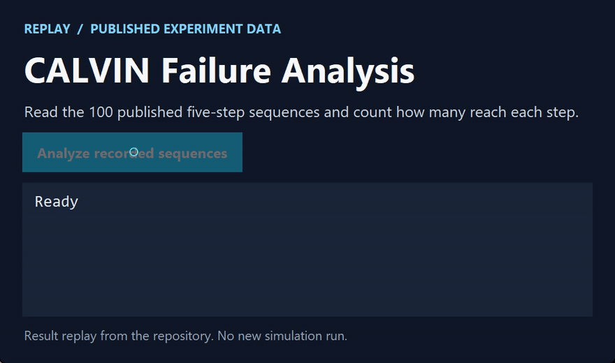

# CALVIN Failure Analysis

[简体中文](https://github.com/chenbinghan666/calvin-failure-analysis/blob/main/README.md) · [English](https://github.com/chenbinghan666/calvin-failure-analysis/blob/main/docs/locales/README.en.md) · **日本語** · [Deutsch](https://github.com/chenbinghan666/calvin-failure-analysis/blob/main/docs/locales/README.de.md) · [Français](https://github.com/chenbinghan666/calvin-failure-analysis/blob/main/docs/locales/README.fr.md) · [Español](https://github.com/chenbinghan666/calvin-failure-analysis/blob/main/docs/locales/README.es.md) · [Português](https://github.com/chenbinghan666/calvin-failure-analysis/blob/main/docs/locales/README.pt.md)

5 ステップのタスクがすべて失敗したとき、ロボットはどこでつまずいたのか。CALVIN シミュレーターと公開 MCIL モデルを使い、動作のずれと失敗後の復帰を調べました。図表、データ、中国語のレポートを収録しています。

Python · CALVIN · MCIL · [実験レポートを見る](https://github.com/chenbinghan666/calvin-failure-analysis/blob/main/docs/report.pdf)

これは、[CALVIN](https://github.com/mees/calvin) シミュレーション環境と公式の MCIL 事前トレーニング モデルに基づく小規模な研究プロジェクトです。

このプロジェクトは次の質問に焦点を当てています: **長距離ロボット タスクの成功率が 0 の場合、ロボットは正確にどこで失敗するのか、なぜ失敗するのか、失敗後に回復できるかどうか。**

従来のタスク レベルの成功率では、最終的な成功または失敗のみが保持され、次の状況を区別できません。

- モデルは最初のステップから開始するわけではありません。
- モデルはいくつかのステップを完了できますが、後続のタスクでエラーが蓄積されます。
- モデルはタスクを理解していますが、継続的な制御は徐々に離れていきます。
- モデルはいくつかの初期状態でのみ成功します。
- モデルは障害後に自力で回復することはできません。

## 操作デモ

公開済みの100件の5ステップ系列を読み込み、各ステップの完了数を数えます。

[](../../docs/images/project-demo.mp4)

[MP4 をダウンロード](../../docs/images/project-demo.mp4?raw=true)

## 実験プロセス

1. 実際のデモンストレーション軌跡を再生して、環境、アクション形式、成功判定を検証します。
2. LED を開く、引き戸を左に動かす、引き出しを開けるという 3 つの単一タスクがそれぞれテストされました。
3. 100 個の固定 5 ステップ プログラム シーケンスを実行し、SR@1 から SR@5 を記録します。
4. 位置、姿勢、グリッパー動作による位置決めの直接的な障害リンクを交換します。
5. 失敗後の再試行と継続診断を修正しました。

## 主な成果

| 実験 | 結果 |
|---|---:|
| LEDをオンにする | 2/9 |
| スライドドア左 | 0/9 |
| 引き出しを開ける | 0/9 |
| 100 回の 5 ステップ シーケンスが正常に完了しました | 0/100 |
| SR@1 | 1% |
| SR@2—SR@5 | 0% |
| リトライ回復を修正 | 0/10 |
| 失敗後も実行を継続する | 0/50ステップ |

LED の成功条件は、独立して実行した後も 94 番目のアクション ステップで完了しており、モデルが完全に機能しないわけではないが、初期状態の影響を受けやすいことを示しています。アクション コンポーネントを比較すると、位置アクションを置き換えただけでは 3 種類のタスクすべてが失敗することがわかりました。自由に実行すると、位置アクションとデモンストレーション軌道の間の距離は 72.9 ～ 194.2 mm に拡大されました。 LED ケースでは、主要なステップでグリッパーの向きが一貫していないこともわかりました。


## 成功事例と失敗事例

| LED の成功事例: はじめに | LED サクセスストーリー: 終了 |
|---|---|
|  |  |

| LED 障害のケース: はじめに | LED故障ケース：360ステップ実行後 |
|---|---|
|  |  |

## 結論

この実験は、タスク レベルの成功率が最終的な完了を測定するのに適していることを示していますが、長期的なタスクの失敗プロセスを説明するには不十分です。少なくとも、最初に失敗したステップ、連続完了長さ、動作コンポーネントの偏差、および回復結果も記録する必要があります。

現在の証拠は、「閉ループの位置偏差が 3 種類のタスクに共通する直接的な障害のリンクである」ことを裏付けていますが、モデル内の唯一の原因を特定するために使用することはできません。この結論は、このプロジェクトで使用される公開重み、デバッグ データ、および実験条件にのみ適用されます。

## プロジェクトの構造

```text
.
├── README.md
├── docs/
│   ├── report.pdf                  # 中国の研究室レポート
│   └── internship-summary.md       # 科学研究インターンシップの概要
├── figures/                        # 概要図とケースのスクリーンショット
├── results/                        # JSON と CSV の実験結果
└── src/                            # 評価および診断コード
```

完全な中国語レポート: [docs/report.pdf](../../docs/report.pdf)

研究の質問の選択、私が完了した作業、科学研究インターンシップ中のデバッグ プロセスおよび研究の制限については、[docs/internship-summary.md](../../docs/internship-summary.md) を参照してください。

## 複製指示

コードは CALVIN 公式環境で実行し、以下を準備する必要があります。

- `calvin_models` を使用した CALVIN 環境。
- 環境 D データまたは公式デバッグ データ。
- 公式 `D_D_static_rgb_baseline` MCIL チェックポイント。
- Python 3.8、PyTorch 1.13.1、PyTorch Lightning 1.8.6、および Hydra 1.1.1。

メインエントランス：

```bash
python src/run_calvin_mcil_cpu.py \
  --dataset-path /path/to/calvin_dataset \
  --train-folder /path/to/D_D_static_rgb_baseline \
  --checkpoint /path/to/mcil_baseline.ckpt \
  --num-sequences 100 \
  --output results/evaluation.json
```

単一タスクの評価およびさまざまな診断スクリプトの目的については、[src/README.md](../../src/README.md) を参照してください。このリポジトリは、CALVIN データセットまたはモデルの重みを再配布しません。

## 研究の境界線

- MCIL パブリック チェックポイントは 1 つだけテストされました。
- データセット全体ではなく、最大 1.3 GB のデバッグ データを使用します。
- CPU 推論を使用するため、実際のロボット実験は行われませんでした。
- 結果は再現可能な段階研究であり、CALVIN の公式ランキング結果を表すものではありません。

## 謝辞

このプロジェクトでは、CALVIN ベンチマーク環境とその公開モデルを使用します。関連するデータ、環境、モデルを使用する場合は、元のプロジェクト ライセンスを遵守し、CALVIN 論文を引用してください。

> Mees et al., *CALVIN: A Benchmark for Language-Conditioned Policy Learning for Long-Horizon Robot Manipulation Tasks*, IEEE Robotics and Automation Letters, 2022.
